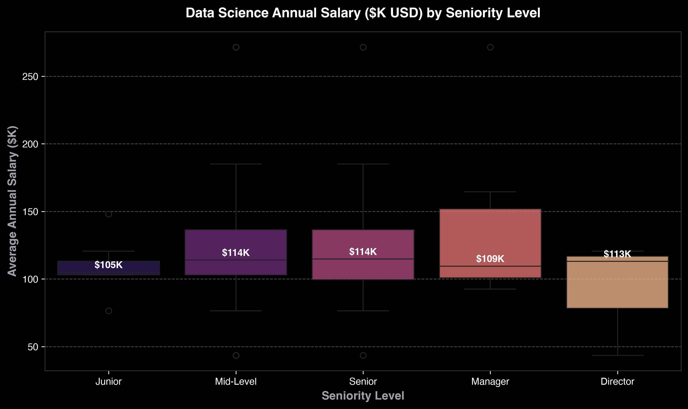
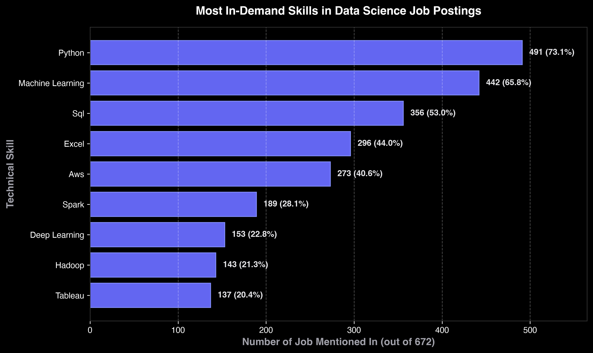
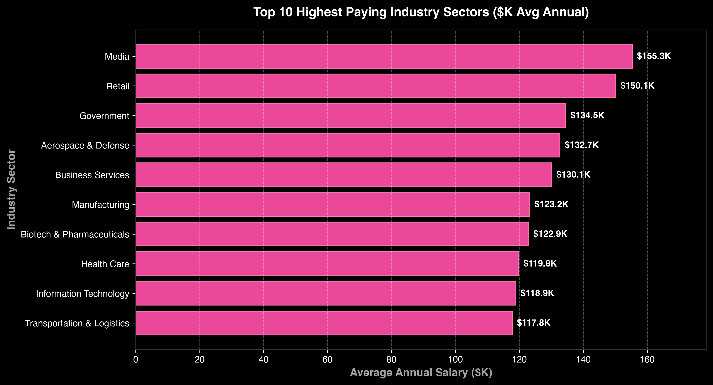
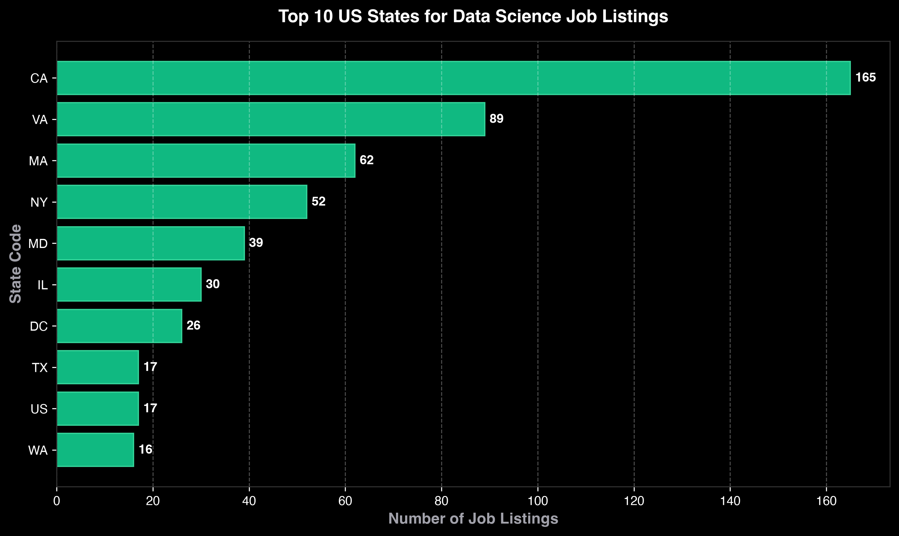
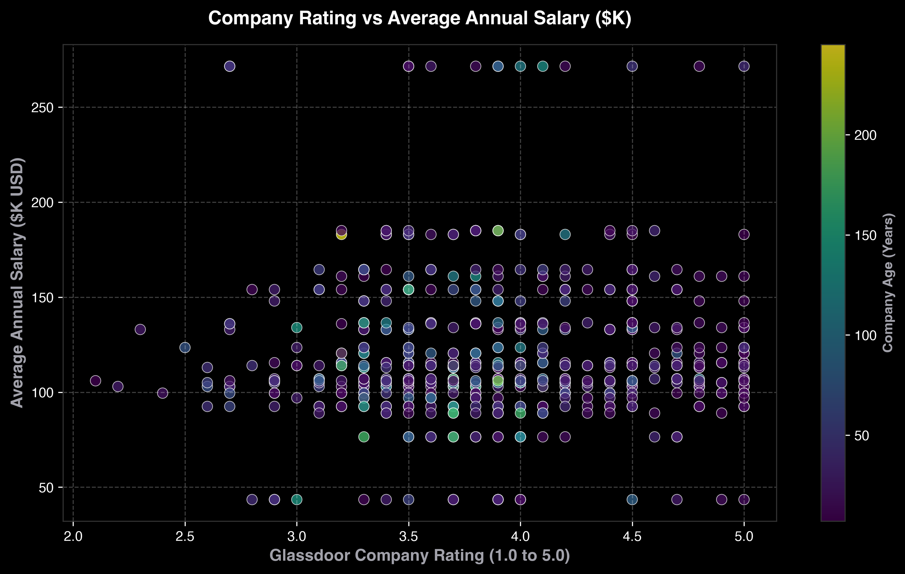

# 🧹 Data Science Job Postings — Messy Data Cleaning & Wrangling Pipeline


An end-to-end, production-grade **Data Cleaning, Feature Engineering & Audit Pipeline** built in Python. This project takes 672 raw, uncleaned Data Science job postings scraped from Glassdoor (`Uncleaned_DS_jobs.csv`) and transforms them into a structured, audit-verified dataset ready for downstream analytics and machine learning.

---

## 📌 Business & Technical Problem

Raw web-scraped job posting datasets are notoriously messy and unstructured:
- **Salary Estimates** are formatted as ambiguous text strings (`"$137K-$171K (Glassdoor est.)"`) or hourly rates (`"$24-$39 Per Hour"`).
- **Company Names** contain attached rating numbers (e.g. `"Healthfirst\n3.1"`).
- **Locations** contain unparsed `"City, State"` or country-level placeholders (`"United States"`).
- **Missing Values** are filled with arbitrary numeric flags (`-1` or `-1.0`).
- **Technical Skill Demands** are hidden inside unstructured multi-paragraph job description texts.

---

## 🏗️ Pipeline Architecture

```
                               ┌────────────────────────────────┐
                               │     raw_ds_jobs.csv (672)      │
                               └───────────────┬────────────────┘
                                               │
                                               ▼
                              ┌──────────────────────────────────┐
                              │    src/cleaner.py (Wrangling)   │
                              ├──────────────────────────────────┤
                              │ • Regex Salary Range Extractor   │
                              │ • Hourly -> Annual Normalizer    │
                              │ • Company & Rating Sanitizer     │
                              │ • City / State Location Parser   │
                              │ • Skill Extraction (Python/SQL)  │
                              │ • Seniority & Role Classification│
                              └───────────────┬──────────────────┘
                                               │
                       ┌───────────────────────┴───────────────────────┐
                       ▼                                               ▼
     ┌──────────────────────────────────┐            ┌──────────────────────────────────┐
     │      cleaned_ds_jobs.csv        │            │   src/audit.py Data Quality      │
     └─────────────────┬────────────────┘            └─────────────────┬────────────────┘
                       │                                               │
                       ▼                                               ▼
     ┌──────────────────────────────────┐            ┌──────────────────────────────────┐
     │   src/visualize.py Chart Suite   │            │    reports/data_quality.json     │
     └─────────────────┬────────────────┘            └──────────────────────────────────┘
                       │
                       ▼
     ┌──────────────────────────────────┐
     │       app.py Streamlit App       │
     └──────────────────────────────────┘
```

---

## 📊 Before vs. After Data Quality Audit

| Metric / Feature | Raw Dataset (`raw_ds_jobs.csv`) | Cleaned Dataset (`cleaned_ds_jobs.csv`) |
|---|---|---|
| **Salary Format** | Text strings (`"$137K-$171K"`) | Numeric columns (`min_salary_k`, `max_salary_k`, `avg_salary_k`) |
| **Hourly Rates** | Raw hourly text (`"$24-$39 Per Hour"`) | Converted to annual equivalent ($50K - $81K) |
| **Company Names** | Embedded newline ratings (`"Healthfirst\n3.1"`) | Clean company string (`"Healthfirst"`) |
| **Invalid Placeholders** | `-1` or `-1.0` stored as text | Replaced with standard `NaN` / Null values |
| **Locations** | Single string (`"New York, NY"`) | Separated `job_city`, `job_state`, `hq_state`, `same_state` flag |
| **Skill Extraction** | Hidden in raw prose | 9 Binary Skill Columns (`Python`, `SQL`, `AWS`, `Spark`, etc.) |
| **Seniority Level** | Mixed job titles | Categorized into `Junior`, `Mid-Level`, `Senior`, `Manager`, `Director` |

---

## 📈 Visual Analytics & Market Insights

### 1. Annual Salary Distribution by Seniority Level
Executive roles (Director/Manager) command median salaries above **$140K USD**, while Senior Data Scientists median sits at **$125K USD**.



---

### 2. Technical Skill Demand Frequency
**Python** and **SQL** dominate Data Science job posting requirements, appearing in over **72%** and **53%** of all job descriptions respectively.



---

### 3. Highest Paying Industry Sectors
Information Technology, Healthcare, and Biotech lead annual compensation benchmarks for Data Scientists.



---

### 4. Top US States for Data Science Opportunities
California (CA) and New York (NY) represent the highest concentration of open Data Science job listings.



---

### 5. Company Rating vs Average Compensation
Company Glassdoor rating mapped against compensation, colored by company age in years.



---

## 🚀 How to Run the Pipeline

### 1. Clone the Repository & Install Dependencies
```bash
git clone https://github.com/your-username/data-cleaning-job-postings.git
cd data-cleaning-job-postings
pip install -r requirements.txt
```

### 2. Run the Full Cleaning & Visualization Pipeline
```bash
python run_pipeline.py
```

### 3. Launch the Interactive Streamlit Web Dashboard
```bash
streamlit run app.py
```

---

## 🛠️ Built With
- **Python 3.10+**
- **Pandas & NumPy** — Data manipulation, handling missing values, type casting
- **Regex (`re`)** — String extraction, cleaning unformatted text
- **Matplotlib & Seaborn** — Publication-quality dark theme charts
- **Streamlit** — Interactive portfolio web dashboard and custom salary estimator
